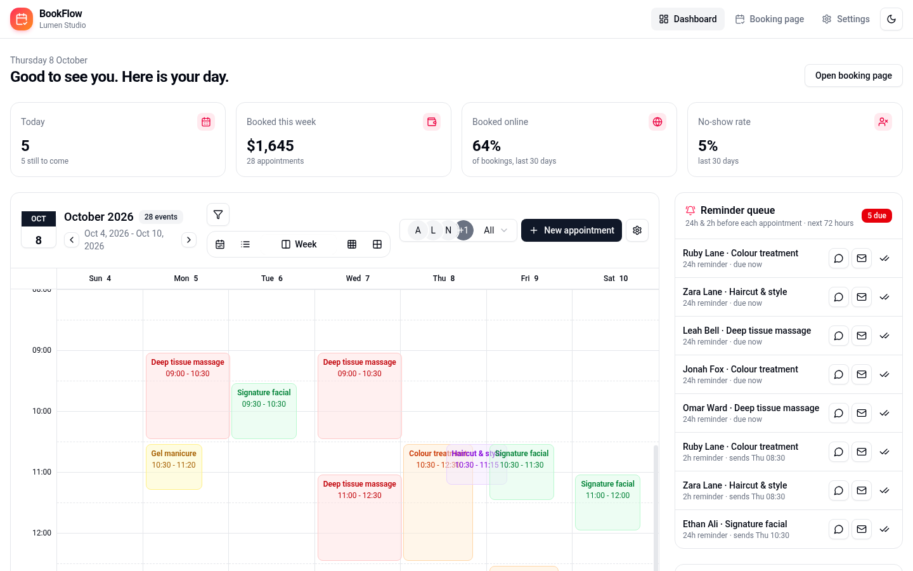
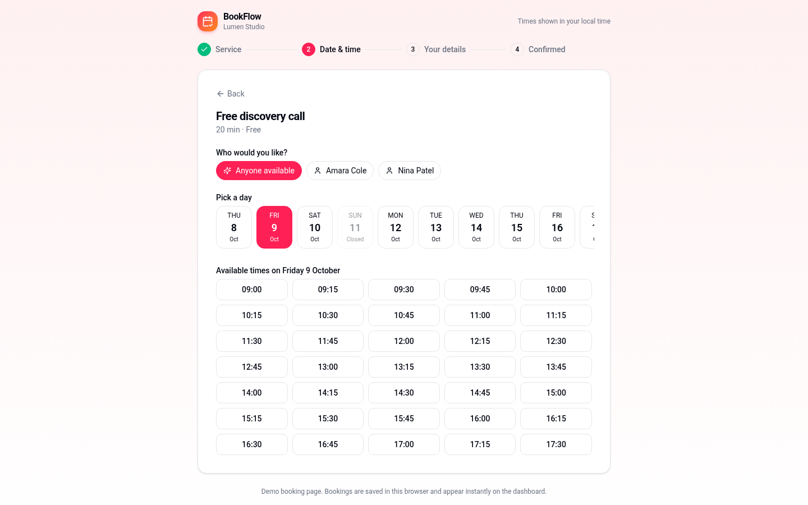
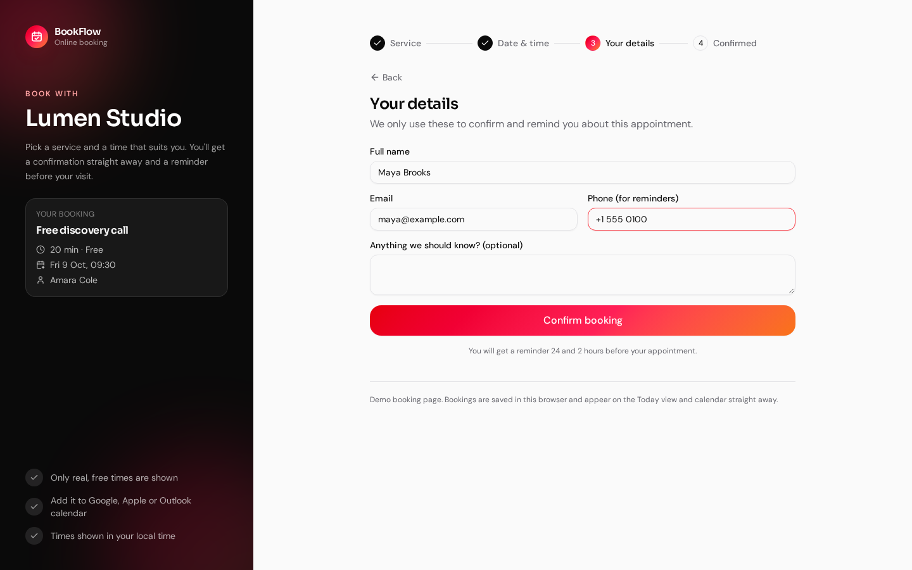
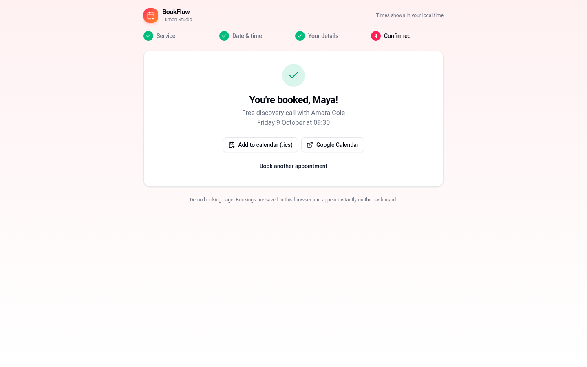
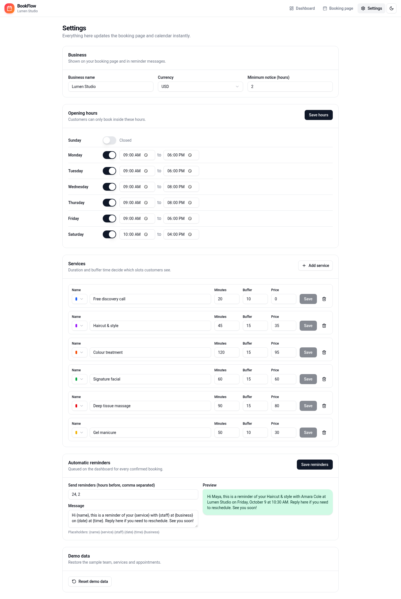
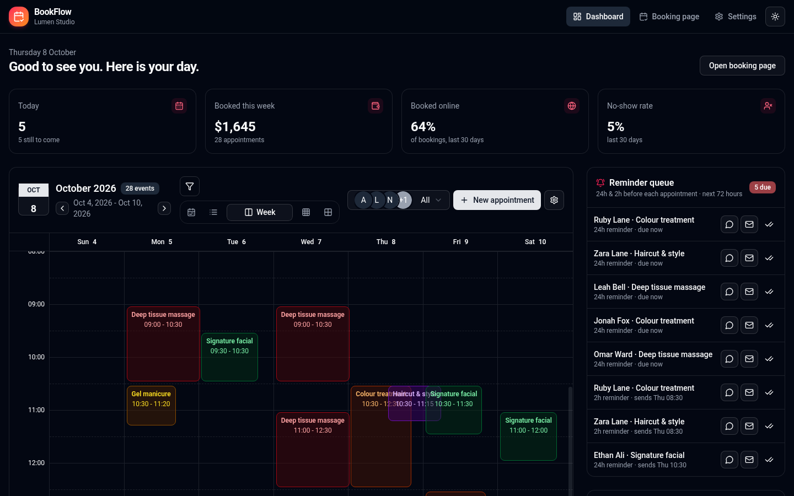
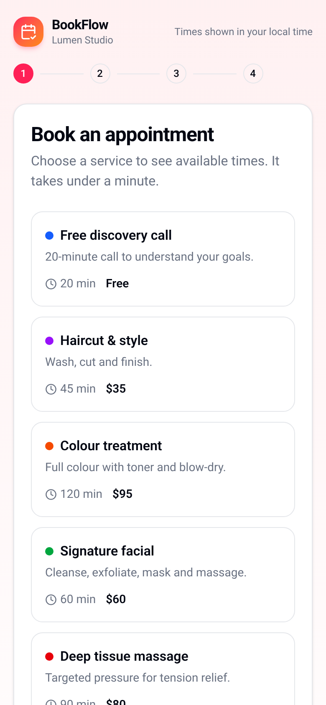

# BookFlow

**Online booking, scheduling and automatic reminders for salons, spas, clinics, studios and other appointment-based businesses.**

Many small service businesses still take bookings by phone, DM and paper diary. That means double-bookings, gaps in the day, and customers who simply forget to show up. BookFlow gives the business a public booking page that only offers times that are actually free, a team calendar that updates as bookings come in, and a reminder queue so every customer gets a message before their appointment.

**Try it:** clone the repo and run it locally in a couple of minutes (see [Run locally](#run-locally)). It opens in demo mode with fictional sample data, so there is nothing to sign up for and no backend to configure.



## Features

### Public booking page (`/book`)
- Four-step flow: service → date & time → details → confirmation, with a progress indicator
- Customers choose a specific team member or **"Anyone available"**, and BookFlow assigns the first free person
- **Real availability engine**: slots respect opening hours, service duration, clean-up buffer time, each team member's existing appointments, minimum notice and how far ahead bookings are allowed. Closed days are greyed out.
- The slot is checked again right before saving, so two people can't grab the same time
- Validated details form (name, email, phone, notes) with clear error messages
- Confirmation screen with **Add to calendar (.ics)** and **Google Calendar** links
- Mobile-first layout

### Team calendar (dashboard)
- Day, week, month, year and agenda views
- Drag and drop to reschedule. Moves that would clash with another appointment for the same team member are blocked.
- Filter by team member and by service colour (the two filters combine)
- Create and edit appointments with service and staff pickers. The end time is filled in from the service duration, and conflicts are caught before saving.
- Appointment details with customer contact info, status actions (completed, no-show, cancel), a one-tap WhatsApp reminder and an .ics download

### Automatic reminders
- Reminder queue for every confirmed appointment in the next 72 hours, built from configurable offsets (for example 24 h and 2 h before)
- Each reminder is marked **due**, **scheduled** or **sent**
- Send in one click via **WhatsApp** (wa.me link with the message pre-filled) or **email**, then mark it as sent
- Editable message template with `{name}`, `{service}`, `{staff}`, `{date}`, `{time}` and `{business}` placeholders and a live preview

### Business insights
- Today's appointments and how many are still to come
- Booked revenue and appointment count for the current week
- Share of bookings made online and no-show rate over the last 30 days
- "Next up" list of upcoming appointments

### Settings
- Business name, currency and minimum notice
- Weekly opening hours editor with validation
- Services editor: name, colour, duration, buffer and price
- Reset to sample data

| Choose a time | Your details |
| --- | --- |
|  |  |
| **Confirmation** | **Settings** |
|  |  |
| **Dark mode** | **Booking page on mobile** |
|  |  |

All names, bookings and figures in the demo are fictional sample data generated in the browser.

## Tech stack

- **Next.js 16** (App Router, static export) with **React 19** and **TypeScript**
- **Tailwind CSS v4**, shadcn/ui and Radix primitives, Framer Motion
- **Zustand** with `persist` for state and local storage
- **React Hook Form** + **Zod** for validation
- **date-fns** for date handling
- **Vitest** unit tests for the availability engine, reminders, calendar export and stats
- **GitHub Actions** for lint, tests and build checks on every push

## Project structure

```
src/
  app/
    page.tsx             # dashboard: KPIs, team calendar, reminder queue
    book/page.tsx        # public booking flow
    settings/page.tsx    # business, hours, services, reminders
  features/
    booking/             # domain logic (pure, unit-tested)
      availability.ts    # slot engine + conflict detection
      reminders.ts       # reminder queue, templates, WhatsApp/email links
      ics.ts             # .ics files and Google Calendar links
      stats.ts           # dashboard metrics
      store.ts           # persisted Zustand store
      seed.ts            # sample services, team and bookings
    calendar/            # calendar views, dialogs, drag and drop
  components/            # navigation, providers, reminder queue, UI primitives
```

The booking rules live in plain TypeScript functions with no UI dependencies, so they can be moved to an API route or backend unchanged when the app gets a database.

## Run locally

**Requirements:** Node.js 20 or newer and pnpm (`npm install -g pnpm` or `corepack enable`).

```bash
git clone https://github.com/gabrielolarinre74-pixel/bookflow.git
cd bookflow
pnpm install
pnpm dev
```

Then open http://localhost:3000.

### Demo mode

The app starts with fictional sample data so every screen (the dashboard, the public booking page (/book) and Settings) has something to show. Everything you add or change is saved in your browser's `localStorage`. Nothing is sent to a server. To start over, use **Reset** in Settings.

### Other commands

```bash
pnpm test
pnpm lint
pnpm build
pnpm start
```

`pnpm build` writes a static site to `out/`, and `pnpm start` serves it. No environment variables or API keys are needed (see `.env.example`).

## Deployment

The production build is a static site, so `out/` can be hosted on Vercel, Netlify, Cloudflare Pages, S3 or any static host. GitHub Actions (`.github/workflows/ci.yml`) runs lint, tests and the build on every push and pull request. A GitHub Pages workflow is included, but it is turned off and only runs if someone starts it by hand.

## Roadmap

- Database and accounts (Supabase or Postgres) so bookings sync across devices
- Automatic sending through the WhatsApp Business API, SMS or email providers
- Deposits and online payment at booking time
- Embeddable booking widget for an existing website

## License

MIT. See [LICENSE](LICENSE).

---

Designed and developed by **Gabriel Zion** · [Gabriel.ATH](https://gabrielzion-portfolio.vercel.app). Websites, apps, automation and UI/UX for growing businesses.
