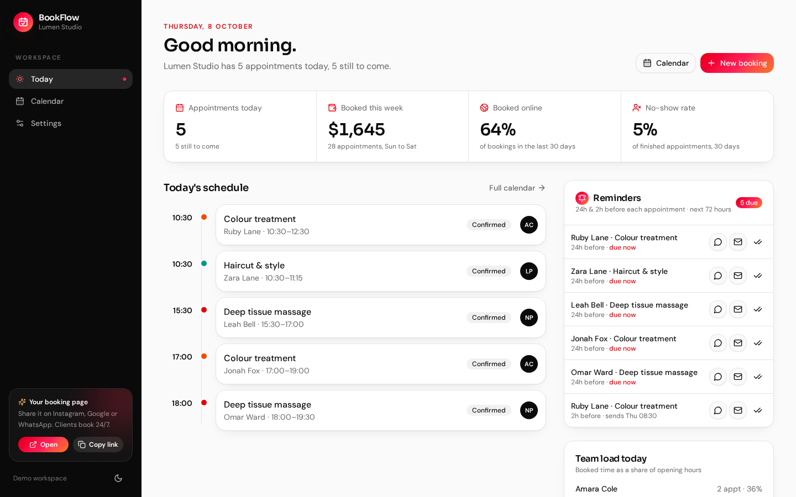
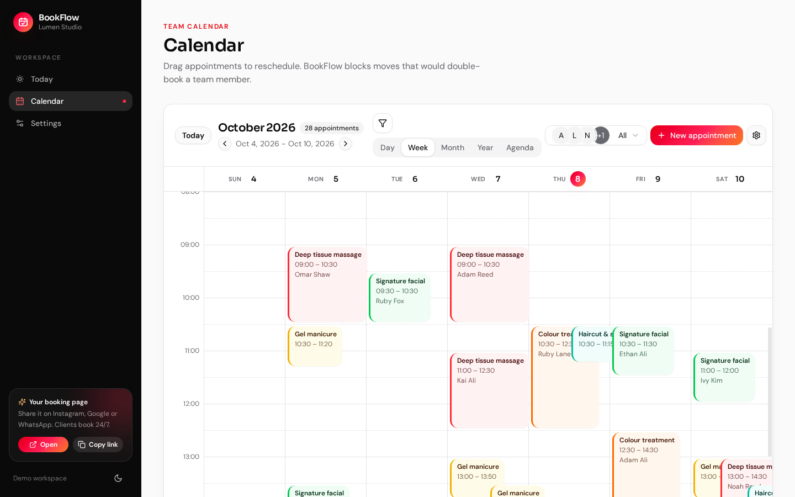
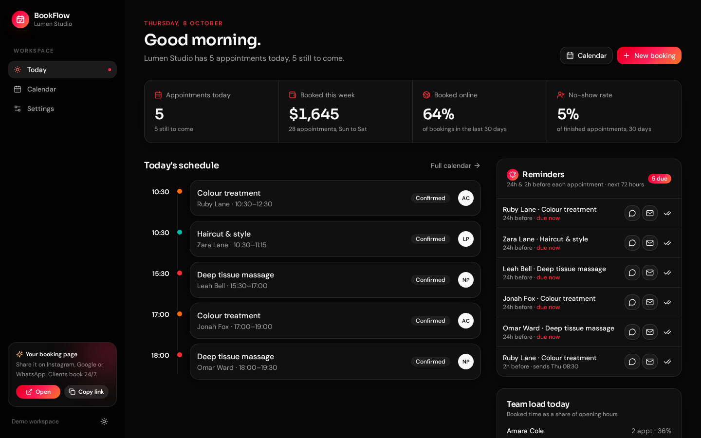

<div align="center">

# BookFlow

**Take bookings while you sleep. Fill your calendar, not your inbox.**

An online booking and reminder system for salons, spas, clinics, studios, coaches and any business that runs on appointments.



</div>

## Why BookFlow

Appointment businesses lose money in three quiet ways: clients who can't book outside opening hours, double-bookings when two people take calls at once, and no-shows from clients who simply forgot. BookFlow handles all three:

1. **A booking page that's always open.** Clients choose a service, a team member and a time on their phone. Only times that are really free are shown.
2. **One calendar for the whole team.** Online and in-person bookings land in the same place, and BookFlow won't let anyone double-book a team member.
3. **Reminders that go out on time.** Every confirmed appointment gets reminders queued at the times you choose, ready to send on WhatsApp or by email in one tap.

## Features

**Booking page**
- Split-screen design: a dark brand panel with a live summary of the booking, and a clean step-by-step flow (service → time → details → done)
- "Anyone available" or a specific team member
- A real availability engine that respects opening hours, service length, clean-up buffers, each person's existing appointments, minimum notice and how far ahead clients can book
- The chosen time is checked again just before saving, so two clients can't take the same slot
- Validated contact form with friendly inline errors
- Confirmation screen with an .ics file (Apple, Outlook) and a Google Calendar link

**Today view**
- Greeting with a one-line summary of the day
- Metrics strip: appointments today, revenue booked this week, share of bookings made online, no-show rate
- Today's schedule as a timeline, with the current appointment marked "In progress"
- **Team load**: how much of each person's day is booked, as a share of opening hours
- Coming-up list for the next confirmed appointments

**Calendar**
- Day, week, month, year and agenda views with a segmented switcher
- Colour-coded appointment cards with the client's name
- Drag to reschedule, with clash detection per team member
- Filters by team member and service that work together
- Create or edit an appointment: pick a service and the end time fills itself in
- Appointment details with client contact info, status (completed, no-show, cancelled), a WhatsApp reminder button and an .ics download

**Reminders**
- Queue built from your reminder times (for example 24 hours and 2 hours before)
- Each reminder is marked due, scheduled or sent
- Send by WhatsApp (message pre-filled) or email, then mark it as sent
- Editable message with `{name}`, `{service}`, `{staff}`, `{date}`, `{time}` and `{business}` placeholders and a live chat-bubble preview

**Settings**
- Business name, currency and minimum notice
- Weekly opening hours with validation
- Services: name, colour, length, buffer and price
- One-click reset to the sample data

## Screenshots

| Pick a time | Your details |
| --- | --- |
|  |  |
| **Booked** | **Team calendar** |
|  |  |
| **Settings** | **Dark mode** |
|  |  |

<p align="center"></p>

The business, team, clients and figures shown are fictional sample data generated in the browser.

## Design

- **Palette:** a red-to-orange gradient for brand moments, on white surfaces with near-black ink and a black sidebar
- **Type:** Sora for headings and numbers, DM Sans for everything else, both self-hosted
- **Details:** soft layered shadows, 14px radius, accent-bar appointment cards, and a glow on primary actions
- Light and dark themes

## Tech stack

| Area | Tools |
| --- | --- |
| Framework | Next.js 16 (App Router, static export), React 19, TypeScript |
| UI | Tailwind CSS v4, Radix primitives, Framer Motion, Lucide icons |
| State | Zustand with versioned `localStorage` persistence |
| Forms | React Hook Form + Zod |
| Dates | date-fns |
| Quality | Vitest unit tests, ESLint, GitHub Actions CI |

```
src/
  app/
    (workspace)/          # Today, Calendar and Settings inside the app shell
    book/                 # public booking page
  features/
    booking/              # availability, reminders, .ics, stats, store, sample data (pure + tested)
    calendar/             # calendar views, dialogs, drag and drop
  components/             # app shell, reminder panel, UI primitives
```

The booking rules are plain TypeScript functions with no UI code, so they can move behind an API unchanged when the app gets a database.

## Run locally

You need Node.js 20+ and pnpm (`corepack enable` or `npm i -g pnpm`).

```bash
git clone https://github.com/gabrielolarinre74-pixel/bookflow.git
cd bookflow
pnpm install
pnpm dev
```

Open http://localhost:3000 for the workspace and http://localhost:3000/book for the client booking page.

**Demo mode.** The app opens with a sample business, team and a month of appointments, so every screen has something to show. Everything you do is saved in your browser's `localStorage`, and nothing is sent anywhere. **Settings → Reset demo data** starts over.

Other commands:

```bash
pnpm test     # unit tests
pnpm lint
pnpm build    # static site in out/
pnpm start    # serve the static build
```

No API keys are needed. `.env.example` lists the one optional setting, used to host the site under a sub-path.

## Hosting

`pnpm build` produces a static site that runs on Vercel, Netlify, Cloudflare Pages, S3 or any static host. CI (`.github/workflows/ci.yml`) lints, tests and builds every push. A GitHub Pages workflow is included but turned off, and only runs if started by hand.

## Roadmap

- Accounts and a database so bookings sync across devices
- Automatic sending through the WhatsApp Business API, SMS or email
- Deposits and card payments at booking
- An embeddable booking widget for existing websites

## License

MIT. See [LICENSE](LICENSE).

---

Designed and developed by **Gabriel Zion** · [Gabriel.ATH](https://gabrielzion-portfolio.vercel.app). Websites, apps, automation and UI/UX for growing businesses.
